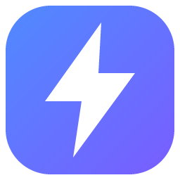
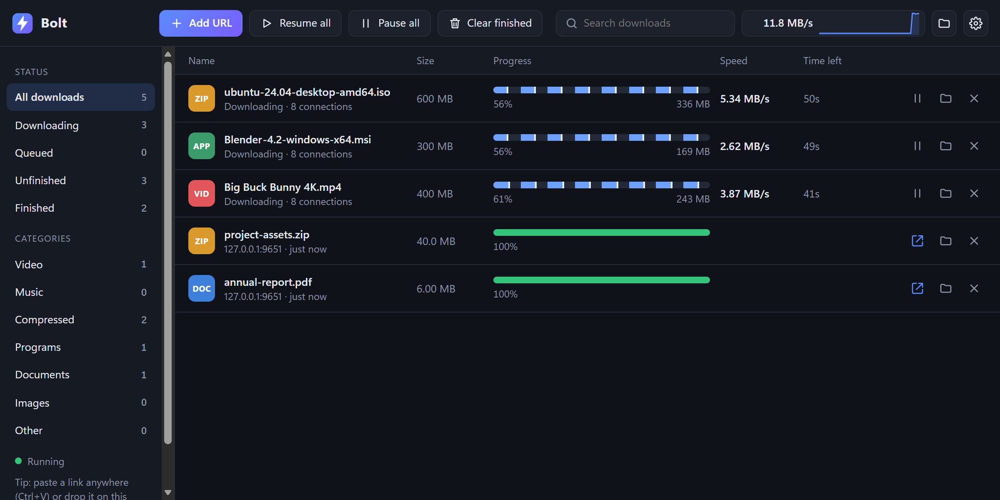
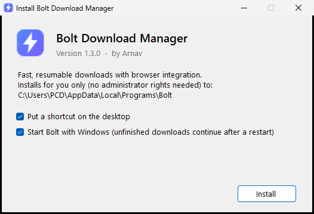

<div align="center">



# Bolt Download Manager

**Fast, unbreakable downloads for Windows. Free, open source, and no ads.**

[](https://github.com/milesARG/bolt-download-manager/releases/latest)
&nbsp;



</div>

## Why Bolt

| | Bolt | IDM | Browser |
|---|:---:|:---:|:---:|
| Price | **Free forever** | Paid (trial) | Free |
| Many connections per file | ✅ up to 32 | ✅ | ❌ |
| Resumes after crashes, sleep and reboots | ✅ | ✅ | ⚠️ |
| Unlimited downloads at once | ✅ | ✅ | ✅ |
| Video streams (HLS) → MP4 | ✅ | ✅ | ❌ |
| Open source, no ads, no tracking | ✅ | ❌ | — |

**What Bolt adds on top:** it never silently throws away progress, catches one-time game-panel backup links, keeps the PC awake while downloading, and puts every download (even Telegram files the browser saves) in one list.

<sub>Tested on files from 1 MB to 200 GB, with every byte checked against the original.</sub>

## Install in 1 minute

1. **[Download the latest release](https://github.com/milesARG/bolt-download-manager/releases/latest)** (`Bolt-1.5.0-share.zip`) and extract it.
2. Run **`Install Bolt 1.5.0.exe`** and click **Install**. You don't need admin rights or anything else.
   <sub>If Windows says "protected your PC", click **More info → Run anyway**. The installer isn't code-signed yet.</sub>
3. **Add the browser extension.** Open `edge://extensions` (or `chrome://extensions`), turn on **Developer mode**, click **Load unpacked**, and pick the **`Browser extension`** folder.
   <sub>Keep that folder somewhere permanent, like Documents. The browser keeps loading it from there.</sub>

That's it. Downloads from your browser now go through Bolt.

<p align="center"></p>

## What it does

- ⚡ **Speed.** Splits each file across up to 32 connections, picked automatically by file size. Files of 100 GB or more get the maximum.
- 🛡️ **Never loses a download.** Survives crashes, Wi-Fi drops, sleep and restarts, and continues from exactly where it stopped.
- 🔗 **Expired link?** Start the download again in your browser and Bolt continues the old one.
- 📁 **Categories.** Make your own, like *Games → D:\games*. Pick one when downloading, or let its file types (iso, rar…) choose it for you.
- 🪟 **Download window.** Choose the folder and speed (Auto, Normal, Fast, Ultra or Max) for every download.
- 🧩 **Works with everything.** Files Bolt can't fetch itself, like Telegram or MEGA, still appear in its list while the browser saves them.
- 🎬 **Video.** Detects videos playing on a page. Saves HLS streams as MP4, and YouTube with [yt-dlp](https://github.com/yt-dlp/yt-dlp).
- 🔔 **Tray icon.** Pause or resume everything from the clock area, and get a notification when a download finishes.

## FAQ

**Is it safe?** Yes. Bolt runs only on your PC (`127.0.0.1`), and websites can't control it. The code is open, and the release files were scanned with Microsoft Defender.

**Where are my files?** In your Downloads folder by default. You can change it in ⚙️ Settings.

**Why is something downloading through my browser?** Some sites (Telegram, MEGA) build files inside the page, and no download manager can fetch those. Bolt still shows them in its list.

**How do I uninstall?** Settings → Apps → *Bolt Download Manager* → Uninstall. Your downloaded files are kept.

## For developers

```bash
node bin/bolt.js start                                   # run from source (Node.js 20+)
node test/run-tests.js                                   # 38 end-to-end tests
powershell -ExecutionPolicy Bypass -File tools\build-release.ps1   # build the installer
```

📖 [Full guide](docs/GUIDE.md) · 📊 [Speed & reliability report](docs/PERFORMANCE.md)

<div align="center"><sub>Made by <b>Arnav</b> · MIT License</sub></div>
